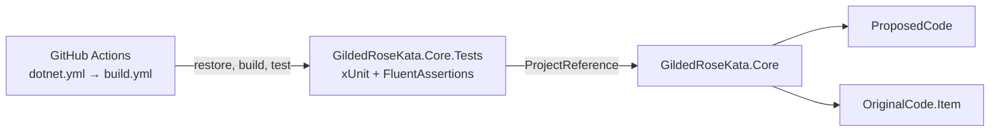

<!-- module: tests/Core.Tests -->
# Core.Tests (GildedRoseKata.Core.Tests)

## Purpose

`tests/Core.Tests` is the xUnit test project for `src/Core` (`GildedRoseKata.Core`), the Gilded Rose kata implementation. It checks the "proposed" refactoring of the kata. That code lives in `src/Core/ProposedCode`, and it models item aging as a small domain: value objects, an item-kind hierarchy, a maturing policy and a service.

The tests cover only `ProposedCode`. Nothing in this module tests `src/Core/OriginalCode/UpdateQualityService.cs`. It does use the original `Item` type from that folder as the input to the service tests.

## Place in the repository

```
GildedRoseKata.sln
├── src/Core/                  GildedRoseKata.Core (code under test)
│   ├── OriginalCode/          Item, UpdateQualityService
│   └── ProposedCode/          Domain/*, IMaturingPolicy, ItemMaturationService
└── tests/Core.Tests/          GildedRoseKata.Core.Tests (this module)
```



## Test layout

All test classes are in the namespace `GildedRoseKata.ProposedCode.Tests`. The folder layout mirrors the `ProposedCode` layout in `src/Core`.

| File | Subject under test | What it verifies |
|---|---|---|
| `ProposedCode/Domain/ItemKindTests.cs` | `ItemKind.FromName` | Maps item names to kinds. `Aged Brie` and `AgedBrie` give `AgedBrie`. `Backstage passes to a TAFKAL80ETC concert` and `Backstage` give `Backstage`. `Conjured Mana Cake` and `Conjured` give `Conjured`. `Sulfuras, Hand of Ragnaros` gives `Sulfuras`. Any other name gives `Standard`. |
| `ProposedCode/Domain/QualityTests.cs` | `Quality` | The constructor clamps values to 0–50. `Increase` caps at 50 and `Decrease` floors at 0. `Reset()` returns 0. `Quality.FromItemKind` returns `Quality.Legendary` for `Sulfuras`. |
| `ProposedCode/Domain/SellInTests.cs` | `SellIn` | `IsExpired` is true only when the value is below 0, so 0 is not expired. `IsBelow(limit)` is a strict comparison. `NextDay()` decrements by one. |
| `ProposedCode/Domain/ItemMaturingPolicyTests.cs` | `ItemMaturingPolicy.Mature(ItemKind, ItemState)` | Per-kind rules, described below. |
| `ProposedCode/ItemMaturationServiceTests.cs` | `ItemMaturationService.Mature(Item)` | Takes an `OriginalCode.Item` with a name, quality and sell-in. Checks that the right rules apply for each resolved kind and that the returned item has the expected `Quality` and `SellIn`. |

### Rules the policy tests pin down

These come from the test data in `ItemMaturingPolicyTests`.

- **Standard**: quality drops by 1 per day, and by 2 once sell-in is 0 or below. Quality never goes below 0. Sell-in drops by 1 per day.
- **Aged Brie**: quality rises by 1, or by 2 once past its sell-by date (sell-in 0 going to -1). It is capped at 50.
- **Backstage**: quality rises by 1 when sell-in is above 10, by 2 when it is 6–10, and by 3 when it is 1–5. It is capped at 50. Quality drops to 0 once the concert has passed (sell-in 0).
- **Conjured**: quality drops by 2 per day, and by 4 once sell-in is 0 or below. It is floored at 0.
- **Sulfuras**: the state is returned unchanged. The test uses `ItemState.Create(new ItemKind.Sulfuras(), 80, 0)`.

## Running the tests

The CI workflow shows the commands:

```bash
dotnet restore
dotnet build --no-restore
dotnet test --no-build --verbosity normal
```

You can also run `dotnet test tests/Core.Tests` locally. The `coverlet.collector` package is referenced for code coverage collection, for example `dotnet test --collect:"XPlat Code Coverage"`.

CI is defined in `.github/workflows/dotnet.yml`. It runs on pushes and pull requests to `master`, and pull requests that change only `.gitignore` or `README.md` are skipped. It calls the reusable `build.yml`, which runs on `ubuntu-latest` with .NET `9.0.x`.

## Project configuration

`GildedRoseKata.Core.Tests.csproj`:

- `IsTestProject=true` and `IsPackable=false`.
- A `Using Include="Xunit"` global using, so test files don't need `using Xunit;`.
- A project reference to `..\..\src\Core\GildedRoseKata.Core.csproj`.
- Shared settings come from the root `Directory.Build.props`: `net8.0`, latest `LangVersion`, nullable and implicit usings enabled, and `TreatWarningsAsErrors=false`. It also adds the Roslynator and SonarAnalyzer analyzers, and analyzers are turned off in Release builds.
- The test project overrides the analyzer package versions to Roslynator.Analyzers 5.0.0 and SonarAnalyzer.CSharp 10.33.0.1635, using `PackageReference Update`.

## Dependencies

| Package | Version | Role |
|---|---|---|
| `xunit` | 2.9.3 | Test framework (`[Fact]`, `[Theory]`, `[InlineData]`) |
| `xunit.runner.visualstudio` | 4.0.0 | Test discovery and execution under `dotnet test` and Visual Studio |
| `Microsoft.NET.Test.Sdk` | 18.9.0 | Test host |
| `FluentAssertions` | 8.10.0 | Assertions (`Should().Be`, `Should().BeOfType`) |
| `coverlet.collector` | 10.0.1 | Code coverage collector |
| `GildedRoseKata.Core` | project reference | Code under test |

## Conventions

- Tests are data-driven. They use `[Theory]` with `[InlineData]` rows holding input and expected values, and `[Fact]` for single cases.
- Test names follow `Method_Condition_ExpectedBehavior`, for example `Mature_WhenKindIsStandard_FollowsExpectedRules`.
- Each file starts with a copyright header (KsiProgramming).
- To add a test, put it under `ProposedCode/` in the folder matching the type's location in `src/Core/ProposedCode`, and use the namespace `GildedRoseKata.ProposedCode.Tests`.
